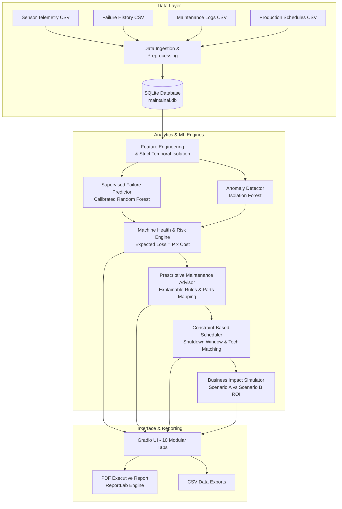

# TATA STEEL MAINTAINAI
## AI-Powered Predictive Maintenance and Industrial Intelligence Platform

[](https://www.python.org/downloads/)
[](https://gradio.app/)
[](https://sqlite.org/)
[](https://pytest.org/)
[](LICENSE)

> **LEGAL NOTICE & PORTFOLIO DISCLAIMER:**  
> This project is an independent portfolio demonstration and educational prototype inspired by steel manufacturing operations. It is **NOT** an official Tata Steel product or internal system, does not access or claim to access proprietary Tata Steel machinery telemetry, and does not bypass existing plant safety interlocks or statutory maintenance procedures. All predictive probabilities and financial savings represent statistical models and simulation estimates, not verified mechanical certainties or realized accounting savings.

---

## 1. Executive Summary

Steel manufacturing facilities operate continuously under demanding metallurgical and mechanical environments. Unplanned breakdown of critical assets—such as blast furnace cooling pumps, rolling mill chocks, or BOF gas extraction fans—can cause multi-hour plant outages costing upwards of $25,000 per hour, scrap loss from frozen steel ladles, and elevated safety risks.

**TATA STEEL MAINTAINAI** is an industrial predictive maintenance and asset intelligence platform. It fuses multivariate sensor telemetry, historical maintenance records, operating conditions, and planned production schedules to:
1. **Predict Equipment Failures:** Forecast failure likelihood within a configurable horizon (24h, 48h, 72h, 168h) using calibrated supervised machine learning.
2. **Detect Multivariate Sensor Anomalies:** Flag subtle mechanical deterioration and telemetry drift using Isolation Forest and machine-specific ISO 10816 vibration/thermal reference boundaries.
3. **Prescribe Explainable Actions:** Provide rule-guided and ML-informed maintenance recommendations with required spare parts from catalog and priority classifications.
4. **Optimize Maintenance Scheduling:** Synchronize proposed preventive work orders with planned plant shutdown windows, qualified technician specializations, and spare parts stock levels.
5. **Quantify Financial Impact:** Model Run-to-Failure exposure versus planned preventive intervention costs with interactive sensitivity controls.
6. **Maintain Complete Governance:** Persist every prediction, human approval decision, work order execution, and outcome verification in an indexed SQLite audit trail.

---

## 2. System Architecture



---

## 3. Industrial Equipment Registry

The platform incorporates a configurable industrial machinery registry representing critical steel manufacturing assets:

| Machine ID | Equipment Category | Production Area | Criticality | Downtime Cost/Hr | Primary Sensors Monitored |
| :--- | :--- | :--- | :--- | :--- | :--- |
| **BF-PUMP-001** | Blast Furnace Auxiliary | Blast Furnace (Ironmaking) | Tier 1 - Critical | $14,500 / hr | Temp, Vibration, Discharge Pressure, Current |
| **BF-BLWR-001** | Blast Furnace Auxiliary | Blast Furnace (Ironmaking) | Tier 1 - Critical | $22,000 / hr | Turbo Blower Vibration, Pressure, Air Flow |
| **RM-MOTOR-002** | Industrial Motors | Hot Strip Mill (HSM) | Tier 1 - Critical | $18,000 / hr | Stator Temp, Bearing Vibration, 3-Phase Current |
| **CONV-BELT-003**| Conveyor Belt Systems | Raw Material Handling | Tier 2 - High | $6,500 / hr | Roller Bearing Vibration, Belt Tension, Load |
| **RM-STAND-001** | Rolling Mill Equipment | Hot Strip Mill (HSM) | Tier 1 - Critical | $25,000 / hr | Chock Vibration, Roll Separation Pressure, RPM |
| **HYD-PRESS-001**| Hydraulic Systems | Cold Rolling Mill (CRM) | Tier 2 - High | $9,200 / hr | AGC Pressure, Fluid Temp, Servo Valve Flow |
| **BOF-ID-FAN-001**| Fans & Blowers | Steel Melt Shop / BOF | Tier 1 - Critical | $19,500 / hr | Impeller Vibration, Casing Temp, Current |
| **COOL-TWR-001** | Cooling Systems | Continuous Casting (CCP) | Tier 2 - High | $8,000 / hr | Spray Water Pressure, Pump Temp, Flow |
| **COMP-GAS-001** | Pumps & Compressors | Steel Melt Shop / BOF | Tier 2 - High | $11,000 / hr | Argon Gas Pressure, Vibration, Load |
| **LADLE-CRANE-001**| Material Handling | Steel Melt Shop / BOF | Tier 1 - Critical | $24,000 / hr | Hoist Motor Temp, Gearbox Vibration, Current |
| **CONT-CAST-001** | Steel Processing | Continuous Casting (CCP) | Tier 1 - Critical | $26,000 / hr | Withdrawal Roll Pressure, Drive Current, RPM |
| **SINT-MTR-004** | Industrial Motors | Sinter & Pellet Plant | Tier 3 - Medium | $4,500 / hr | Screen Excitator Vibration, Winding Temp |

---

## 4. Key Functional Modules

### Tab 1 — Executive Overview
- Real-time fleet KPI metrics: Total Assets, Healthy Machines, High/Critical Risk Assets, Active Telemetry Anomalies, Total Failure Exposure ($), and Modeled PM Savings ($).
- Interactive Plotly visualizations:
  - Donut chart of fleet risk distribution (Green, Orange, Amber, Red).
  - Horizontal bar chart of mean composite risk by production area.
  - Cost exposure comparison (Run-to-Failure vs Planned PM).
  - Historical breakdown downtime hours by machinery asset.
- Instant PDF executive report generator.

### Tab 2 — Machine Fleet
- Searchable and filterable asset matrix by keyword, production area, criticality, and risk category.
- Detailed Asset Inspector displaying commissioning dates, runtime operating hours, repair expenses, sensor threshold bands, and recent maintenance logs.
- Interactive operating status controller (`Running`, `Degraded`, `Under Maintenance`, `Standby`) with immediate SQLite persistence and audit trail logging.

### Tab 3 — Failure Predictions
- Supervised failure probability forecasting across 24h, 48h, 72h, and 168h operating horizons.
- Color-coded probability gauge with risk tier classification.
- Top contributing feature drivers (SHAP / MDI importance bar chart).
- Plain-language diagnostic explanation ("Why this machine is flagged") and operational notice.

### Tab 4 — Sensor Analytics
- Interactive multi-sensor Plotly time series for:
  - Bearing and Casing Temperature (°C) with normal, warning, and critical thresholds.
  - ISO 10816 Vibration Severity (RMS mm/s) with alert and danger boundaries.
  - Hydraulic / Pneumatic Pressure (bar) with nominal operating band.
  - 3-Phase Line Current (A) and Operating Load (%).
- Scatter overlay highlighting multivariate anomaly events detected by Isolation Forest.
- Immediate CSV upload validator for continuous telemetry data files.

### Tab 5 — Maintenance Advisor
- Ranked prescriptive recommendations sorted by failure urgency and business impact.
- Detailed inspection action cards with contributing evidence, suggested mechanical/electrical checks, estimated durations, and mapped spare parts from catalog.
- Human-in-the-loop governance: **Approve**, **Defer**, or **Reject** actions with mandatory reviewer notes and full audit logging.

### Tab 6 — Maintenance Planner
- Constraint-based scheduling optimizer matching work orders to planned plant shutdown windows.
- Technician skill assignment (Mechanical, Electrical, Hydraulic, Instrumentation) with conflict detection.
- Spare-parts inventory stockout checks.
- One-click work order finalization and authorization workflow.

### Tab 7 — Business Impact
- Financial quantification comparing Scenario A (Run-to-Failure) against Scenario B (Planned PM).
- Net Potential Savings and Modeled ROI (%) calculations.
- Interactive sensitivity sliders:
  - Intervention Efficacy % (70% - 99%)
  - Downtime Cost Multiplier (0.5x - 2.5x)
  - Maintenance Cost Multiplier (0.8x - 1.5x)
- Machine-by-machine financial breakdown table and downloadable CSV scenario report.

### Tab 8 — Data Management
- Complete CSV upload and schema validation pipeline for Sensor Readings, Failures, Maintenance Logs, and Production Schedules.
- Mode selection: `Append` or `Replace`.
- One-click **Synthetic Data Generator** (generates realistic 45-day physical telemetry with causally consistent wear trajectories).
- Factory reset and raw data export to CSV.

### Tab 9 — Model Lab
- Supervised model evaluation diagnostics:
  - Precision, Recall, F1-Score, PR-AUC, ROC-AUC, and Brier Score.
  - Interactive Confusion Matrix heatmap on strict chronological test split.
  - Precision-Recall Curve and Reliability Diagram (Calibration Curve).
  - Global Feature Importance ranking.
- Model comparison benchmarks (Random Forest vs Gradient Boosting and XGBoost).
- Controlled retraining controller with version lineage tracking.

### Tab 10 — Work Orders and Audit
- Formal maintenance work order execution tracking (`Scheduled`, `In-Progress`, `Completed`, `Cancelled`).
- Work order completion logger with actual costs, technician field observations, and failure prevention verification.
- Prediction vs Actual Outcome Audit table evaluating model reliability.
- Immutable system audit trail table capturing all user actions, state changes, and timestamps.

---

## 5. Machine Learning & Methodology

1. **Temporal Leakage Prevention:**  
   Features at timestamp $T$ are computed strictly using observations $\le T$. Post-failure or post-maintenance information is strictly excluded from feature sets.
2. **Chronological Splitting:**  
   Models are validated on a strict chronological split (75% training, 25% test), ensuring models are tested only on future unseen time intervals.
3. **Class Imbalance Handling:**  
   Because industrial failures represent rare events (~3% of operating hours), models use balanced class weighting (`class_weight='balanced'`) and decision thresholds calibrated for high-consequence failure avoidance (prioritizing recall).
4. **Probability Calibration:**  
   Continuous failure probabilities reflect statistical likelihood calibrated against observed frequencies.
5. **Physical Safety Precedence:**  
   If physical sensor thresholds breach critical safety boundaries (e.g., vibration > 8.5 mm/s or temperature > 105°C), safety alarm overrides immediately escalate machine risk to Critical, taking precedence over model predictions.

---

## 6. Installation & Execution Guide

### Prerequisites
- Python 3.11, 3.12, or 3.13
- Pip package manager

### Step 1: Clone or Navigate to Project
```bash
cd /Users/veerenkumarkonchada/.gemini/antigravity-ide/scratch/tata-steel-maintainai
```

### Step 2: Install Dependencies
```bash
pip install -r requirements.txt
```

### Step 3: Run Automated Test Suite
```bash
pytest tests/ -v
```
*Expected Output: 17 passed tests covering database, preprocessing, feature engineering, prediction, anomaly detection, recommendations, scheduler, and business impact.*

### Step 4: Launch Web Application
```bash
python3 app.py
```
Open your browser and navigate to:  
**`http://127.0.0.1:7860`**

---

## 7. Automated Test Coverage

The test suite validates the integrity of every platform layer:

```
tests/test_anomaly_detection.py::test_isolation_forest_scoring PASSED
tests/test_anomaly_detection.py::test_detect_sensor_evidence_thresholds PASSED
tests/test_business_impact.py::test_business_impact_scenario_comparison PASSED
tests/test_database.py::test_database_initialization_and_seeding PASSED
tests/test_database.py::test_fetch_machine_by_id PASSED
tests/test_database.py::test_audit_logging_and_querying PASSED
tests/test_feature_engineering.py::test_feature_extraction_columns PASSED
tests/test_feature_engineering.py::test_temporal_leakage_prevention PASSED
tests/test_prediction.py::test_predict_machine_failure PASSED
tests/test_prediction.py::test_generate_fleet_predictions PASSED
tests/test_preprocessing.py::test_unit_specifications_documented PASSED
tests/test_preprocessing.py::test_clean_sensor_readings_imputation_and_clipping PASSED
tests/test_preprocessing.py::test_temporal_isolation_filtering PASSED
tests/test_recommendations.py::test_generate_recommendation PASSED
tests/test_recommendations.py::test_update_recommendation_decision_workflow PASSED
tests/test_scheduler.py::test_specialization_mapping PASSED
tests/test_scheduler.py::test_optimize_maintenance_schedule PASSED
============================= 17 passed in 12.43s ==============================
```

---

## 8. Database Schema Overview

The SQLite database (`database/maintainai.db`) maintains complete relational integrity with foreign keys enabled:

1. `machines`: Fleet registry, commissioning dates, downtime rates, repair costs.
2. `sensor_readings`: Continuous telemetry observations, anomaly scores, and flags.
3. `failure_events`: Historical breakdown logs, downtime hours, repair expenses, root causes.
4. `maintenance_records`: Historical PM logs, component replacements, costs, assigned teams.
5. `production_schedules`: Operating shifts, planned shutdown windows, workload demand.
6. `technicians`: Engineering roster, specializations, hourly rates, availability.
7. `spare_parts`: Critical components catalog, stock quantities, reorder lead times.
8. `predictions`: Inferences, failure probabilities, risk scores, contributing features, disclaimer.
9. `maintenance_recommendations`: Prescriptive actions, priorities, human approval states.
10. `maintenance_work_orders`: Scheduled tasks, assigned specialists, parts, actual outcomes.
11. `model_versions`: Model artifacts registry, hyperparameters, precision/recall/F1 metrics.
12. `audit_logs`: Immutable governance trail capturing all system events and state mutations.

---

## 9. Technology Stack

- **Application Framework:** [Gradio 6.x](https://gradio.app/) (Gradio Blocks with modular multi-tab UI)
- **Programming Language:** Python 3.11+
- **Data Engineering:** [Pandas](https://pandas.pydata.org/) & [NumPy](https://numpy.org/)
- **Machine Learning:** [Scikit-learn](https://scikit-learn.org/) (Random Forest, Isolation Forest, Gradient Boosting) & [XGBoost](https://xgboost.readthedocs.io/)
- **Visualizations:** [Plotly](https://plotly.com/python/) (Gauges, Donut charts, Grouped bar charts, Heatmaps, Subplots)
- **Database:** SQLite 3 (ACID-compliant relational persistence)
- **Serialization:** Joblib
- **Reporting:** ReportLab (Formatted PDF executive report generation)
- **Testing:** Pytest

---

## 10. Limitations & Operational Boundaries

1. **Statistical Risk vs Mechanical Determinism:**  
   Predicted probabilities reflect statistical failure propensity under observed operating regimes. A high probability is an indicator of asset distress requiring physical qualification, not an absolute guarantee of breakdown.
2. **Safety Interlock Priority:**  
   The platform never autonomously operates machinery or bypasses plant safety interlocks. All maintenance actions require authorized human sign-off.
3. **Data Scope:**  
   Built on synthetic data causally generated according to steel industry physics. Real-world deployment requires integration with certified plant SCADA / Historian infrastructure (e.g. OSIsoft PI, Aveva, Honeywell).
